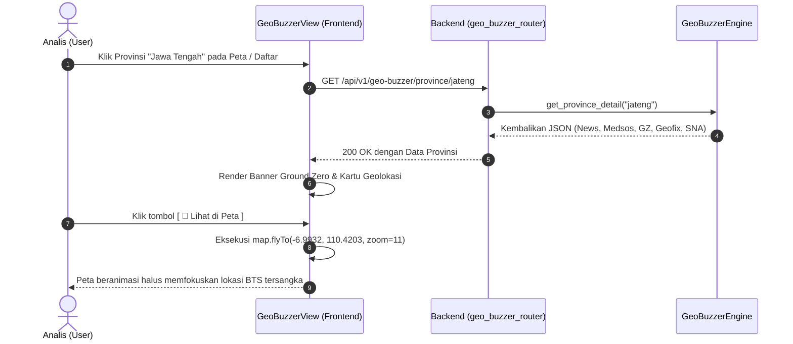
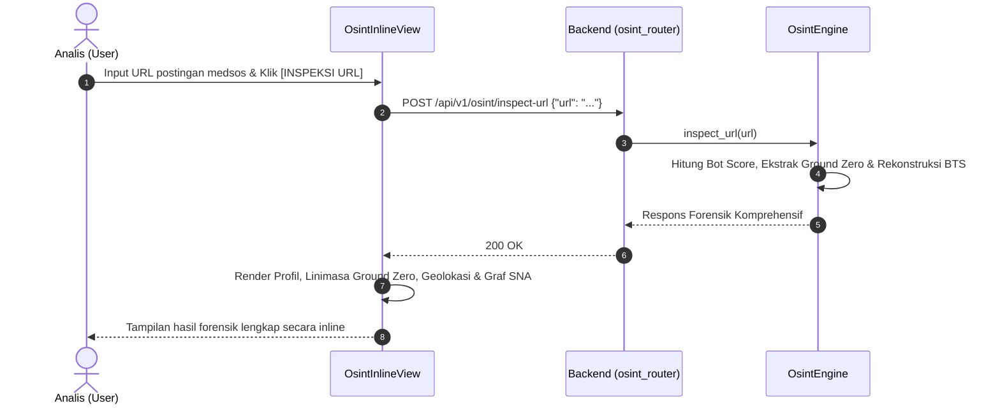

# FUNCTIONAL SPECIFICATION DOCUMENT (FSD)
## PROYEK: KOMANDO
### KOMANDO MONITORING DAN ANALISIS NARASI DIGITAL ONLINE
**Sistem Intelijen Media Sosial, Forensik Akun, & Peta Sebaran Buzzer 38 Provinsi**

---

**Nomor Dokumen**: FSD-KOMANDO-2026-004  
**Versi**: 4.0.0  
**Tanggal Rilis**: 29 Oktober 2026  
**Status**: APPROVED & IMPLEMENTED  
**Target Pengguna**: Tim Rekayasa Perangkat Lunak, DevOps, QA, dan Analis Sistem  
**Role Pengguna**: `user`, `admin`  

---

## DAFTAR ISI

1. [ARSITEKTUR SISTEM & TOPOLOGI KOMPONEN](#1-arsitektur-sistem--topologi-komponen)
2. [DIAGRAM ALIRAN DATA & INTEGRASI MODUL](#2-diagram-aliran-data--integrasi-modul)
3. [SPESIFIKASI ENGINE ANALITIK BACKEND](#3-spesifikasi-engine-analitik-backend)
   - [3.1 GeoBuzzerEngine (38 Provinsi, Ground Zero, Geofix & Flight Lines)](#31-geobuzzerengine-38-provinsi-ground-zero-geofix--flight-lines)
   - [3.2 OsintEngine (URL Profiler, GAN Avatar Detector, Topic Cloud & Account Comparator)](#32-osintengine-url-profiler-gan-avatar-detector-topic-cloud--account-comparator)
   - [3.3 BotEngine & HoaxEngine (XAI & Bot Score)](#33-botengine--hoaxengine-xai--bot-score)
4. [SPESIFIKASI API BACKEND (REST & DATA CONTRACTS)](#4-spesifikasi-api-backend-rest--data-contracts)
   - [4.1 GET /api/v1/geo/buzzer-distribution](#41-get-apiv1geobuzzer-distribution)
   - [4.2 GET /api/v1/geo/propagation-lines](#42-get-apiv1geopropagation-lines)
   - [4.3 POST /api/v1/osint/inspect-url](#43-post-apiv1osintinspect-url)
   - [4.4 POST /api/v1/osint/compare-accounts](#44-post-apiv1osintcompare-accounts)
5. [SPESIFIKASI MODUL & KOMPONEN FRONTEND](#5-spesifikasi-modul--komponen-frontend)
   - [5.1 Komponen Sidebar & TopBar](#51-komponen-sidebar--topbar)
   - [5.2 Komponen KomandoDashboardView (Rute 1: Dasbor Eksekutif)](#52-komponen-komandodashboardview-rute-1-dasbor-eksekutif)
   - [5.3 Komponen GeoBuzzerView (Rute 2: Peta 38 Provinsi & SNA Full Canvas)](#53-komponen-geobuzzerview-rute-2-peta-38-provinsi--sna-full-canvas)
   - [5.4 Komponen PelacakAkunMedsosView (Rute 3: Forensik Akun Medsos)](#54-komponen-pelacakakunmedsosview-rute-3-forensik-akun-medsos)
   - [5.5 Komponen MyAgentView (Rute 4: Agen AI Otonom)](#55-komponen-myagentview-rute-4-agen-ai-otonom)
   - [5.6 Komponen GuideModal & Layanan API Klien](#56-komponen-guidemodal--layanan-api-klien)
6. [SEQUENCE DIAGRAM ALUR KERJA UTAMA](#6-sequence-diagram-alur-kerja-utama)
7. [MANAJEMEN ENERGI, MEMORI & FALLBACK HANDLING](#7-manajemen-energi-memori--fallback-handling)

---

## 1. ARSITEKTUR SISTEM & TOPOLOGI KOMPONEN

Sistem **KOMANDO** mengadopsi arsitektur terpisah (*Decoupled Client-Server Monorepo*):
* **Frontend**: Single Page Application (SPA) berbasis Vanilla JavaScript ES6 modern dan Vite 5, meminimalkan latensi render DOM serta mengintegrasikan visualisasi peta interaktif dan graf jaringan Apache ECharts 5 dengan ResizeObserver.
* **Backend**: Layanan asinkron Python FastAPI berkecepatan tinggi yang menangani komputasi analitik, penguraian OSINT, pemetaan 38 provinsi Indonesia, rekonstruksi Ground Zero, dan kalkulasi BTS geolokasi.

```
+-------------------------------------------------------------------------------+
|                            CLIENT PERAMBAN (FRONTEND SPA)                     |
|  +-------------------------------------------------------------------------+  |
|  |                             KOMANDO Application                         |  |
|  |  [Sidebar] (Navigasi 4 Rute, Profil Operator, Collapse Toggle)          |  |
|  |  [TopBar] (Menu Trigger, Filter Rentang Waktu 24h-30d, DEFCON Pill)     |  |
|  |                                                                         |  |
|  |  RUTE 1: [KomandoDashboardView]                                         |  |
|  |   - 4 KPI Metrik Reaktif (Percakapan, Interaksi, Jangkauan, Penulis)    |  |
|  |   - Trend Analysis & Share of Voice                                     |  |
|  |   - Top Hashtags, Top Authors, Gender, Top Words, Virality Tracker      |  |
|  |   - Barometer DEFCON 1-5 & Early Warning System                         |  |
|  |                                                                         |  |
|  |  RUTE 2: [GeoBuzzerView]                                                |  |
|  |   - Peta Interaktif GeoJSON 38 Provinsi ECharts & Flight Lines          |  |
|  |   - Jejaring Aktor (SNA Full Canvas Force Layout dengan ResizeObserver) |  |
|  |   - Deteksi Ground Zero & Geofix BTS Radar                              |  |
|  |   - Feed Medsos Live vs Berita Daerah Terverifikasi Dewan Pers          |  |
|  |                                                                         |  |
|  |  RUTE 3: [PelacakAkunMedsosView]                                        |  |
|  |   - Multi-Platform OSINT Profiler (X, TikTok, IG, FB, Threads, YouTube) |  |
|  |   - Skor Probabilitas Bot Terpadu (Entropi, Burst Temporal, Kluster)   |  |
|  |   - Grafik Batang Historis Aktivitas 30 Hari                            |  |
|  |                                                                         |  |
|  |  RUTE 4: [MyAgentView]                                                  |  |
|  |   - AI Agent Management Form & Multi-Step Execution Simulation          |  |
|  |   - Persistensi LocalStorage untuk Konfigurasi & Status Agen            |  |
|  |                                                                         |  |
|  |  MODAL: [GuideModal] (Buku Panduan Operasional Sistem & Glosarium)      |  |
|  +-------------------------------------------------------------------------+  |
+--------------------------------------|----------------------------------------+
                                       | HTTP REST API (Fetch JSON)
+--------------------------------------v----------------------------------------+
|                            FASTAPI BACKEND SERVICE                            |
|  +-------------------------------------------------------------------------+  |
|  | REST Routers:                                                           |  |
|  |  - /api/v1/geo-buzzer  -> geo_buzzer_router.py (38 Provinces, GZ, BTS)   |  |
|  |  - /api/v1/osint       -> osint_router.py (Inspect URL, Search Ingest)  |  |
|  |  - /api/v1/hoax, /sna, /cib, /ews, /sentiment (Auxiliary / Legacy APIs) |  |
|  +-------------------------------------------------------------------------+  |
|  | Core Analytic Engines:                                                  |  |
|  |  - GeoBuzzerEngine    (38 Provinsi DB, Ground Zero, BTS Cell, News/SNA) |  |
|  |  - OsintEngine        (Scraper oEmbed, Geolocation Fix, Cross-SNA)      |  |
|  |  - BotEngine          (Unified Bot Index S_bot: 30% Ent, 35% Temp, 35% J)|  |
|  |  - HoaxEngine         (5 Taxonomy, Evidence Tokens, XAI Rationale)      |  |
|  +-------------------------------------------------------------------------+  |
+-------------------------------------------------------------------------------+
```

---

## 2. DIAGRAM ALIRAN DATA & INTEGRASI MODUL

```
                 [Pengguna Memilih Provinsi di Peta / Daftar]
                                      |
                                      v
                        [GET /geo-buzzer/province/{id}]
                                      |
                                      v
                            [GeoBuzzerEngine]
           +--------------------------+--------------------------+
           |                          |                          |
           v                          v                          v
  [Ground Zero Analysis]     [Geolocation & BTS]       [News vs Medsos]
   - Akun Sumber Pertama      - Koordinat GPS           - Rilis Berita Pemda
   - Stempel Waktu Rilis      - Menara BTS Sektor       - Postingan Buzzer
   - Kecepatan Propagasi      - ISP Backbone            - Cross-Platform SNA
           |                          |                          |
           +--------------------------+--------------------------+
                                      |
                                      v
                     [Render di GeoBuzzerView Panel]
                   [Aksi Klik: "📍 Lihat di Peta" -> flyTo]
```

---

## 3. SPESIFIKASI ENGINE ANALITIK BACKEND

### 3.1 GeoBuzzerEngine (38 Provinsi, Ground Zero, Geofix & Flight Lines)
* **File Lokasi**: `backend/app/core/geo_buzzer_engine.py`
* **Struktur Data Master**: Berisi data lengkap 38 provinsi di Indonesia yang mencakup:
  - Identitas: `id`, `name`, `capital`, `lat`, `lng`.
  - Metrik: `buzzer_nodes`, `reach`, `high_risk` (boolean).
  - Ground Zero: `origin_account`, `origin_platform`, `date_time_release`, `propagation_speed`, `propagation_timeline`.
  - Geofix: `latitude`, `longitude`, `city`, `province`, `bts_cell`, `isp`, `ip_origin`, `device_signature`.
  - Konten Komparasi: `news` (berita lokal terverifikasi) dan `social_posts` (cuitan/postingan buzzer di wilayah tersebut).
  - Jaringan: `sna_nodes` dan `sna_links` multi-platform.
* **Metode Inti**:
  - `get_all_provinces()`: Mengembalikan daftar seluruh 38 provinsi dengan metadata ringkas.
  - `get_province_detail(prov_id)`: Mengembalikan profil mendalam satu provinsi beserta Ground Zero, geofix, dan hierarki kluster.
  - `get_provinces_summary()`: Mengembalikan agregasi nasional (76 koordinator inti, 1.250+ botnet amplifiers, total reach >36,8 juta netizen).
  - `_crawl_live_regional_news(prov_name)`: Live crawler RSS Google News Indonesia (Antara, Kompas, Detik, CNN Indonesia) dengan cache in-memory 10 menit.
  - `get_regional_news(prov_name)`: Menyajikan artikel berita terkini terverifikasi Dewan Pers per provinsi terpilih.
  - `get_propagation_flight_lines(province_name, timeframe)`: Menghasilkan rute penerbangan isu (*flight lines*) antar provinsi dengan koordinat asal/tujuan, narasi spesifik, kecepatan replikasi (*cph*), dan volume interaksi berdasar timeframe (`1h`, `6h`, `24h`, `7d`).

### 3.2 OsintEngine (URL Profiler, GAN Avatar Detector, Topic Cloud & Account Comparator)
* **File Lokasi**: `backend/app/core/osint_engine.py`
* **Metode Inti**:
  - `inspect_url(url)`:
    - Melakukan inspeksi terhadap URL yang diinput pengguna.
    - Mengambil metadata postingan dan profil akun via oEmbed atau parser cerdas.
    - Menghitung Unified Bot Index dan klasifikasi hoaks XAI.
    - Membangun blok forensik `origin_forensics` (Ground Zero, datetime release, timeline delta).
    - Membangun blok forensik `geolocation` (GPS, BTS sektor, ISP backbone).
    - Menghasilkan struktur graf `cross_platform_sna` yang memetakan relasi akun X, Instagram, Facebook, Threads, dan Bot Farms.
    - Membangun blok `avatar_forensics` (probabilitas AI GAN %, arsitektur StyleGAN/Diffusion, dan marker simetri pupil & artefak).
    - Mengekstrak `topic_cloud` (daftar kata kunci amplified, frekuensi sebutan, sentimen ancaman).
  - `compare_accounts(url_a, url_b)`:
    - Membandingkan dua URL profil/postingan secara side-by-side.
    - Menghitung indeks kesamaan leksikal Jaccard, selisih waktu unggah (*temporal delta seconds*), kedekatan subnet menara BTS, dan kesamaan *device fingerprint*.
    - Menghasilkan skor sinkronisasi gabungan (0–100%) dan vonis apakah akun dikendalikan oleh operator tunggal.

---

## 4. SPESIFIKASI API BACKEND (REST & DATA CONTRACTS)

### 4.1 `GET /api/v1/geo-buzzer/distribution`
Parameter Query: `platform` (`all`, `X`, `INSTAGRAM`, `FACEBOOK`), `threat` (`all`, `HIGH`, `MEDIUM`).
Mengembalikan array koordinat titik sebaran buzzer dengan followers, bot_score, amplifiers_count, dan narasi.

### 4.2 `GET /api/v1/geo-buzzer/propagation-lines`
Parameter Query: `province` (default: `DKI JAKARTA`), `timeframe` (`1h`, `6h`, `24h`, `7d`).
Mengembalikan:
```json
{
  "province": "DKI JAKARTA",
  "timeframe": "24h",
  "lines_count": 3,
  "lines": [
    {
      "from_name": "DKI JAKARTA",
      "from_coords": [106.8456, -6.2088],
      "to_name": "JAWA BARAT",
      "to_coords": [107.6191, -6.9175],
      "speed_cph": 450,
      "narrative": "Boikot massal & politisasi bansos",
      "volume": 12800,
      "timeframe": "24h"
    }
  ]
}
```

### 4.3 `POST /api/v1/osint/inspect-url`
Body: `{"url": "https://x.com/akun/status/123"}`
Menghasilkan objek analisis instan lengkap dengan `origin_forensics`, `geolocation`, `cross_platform_sna`, `avatar_forensics`, dan `topic_cloud`.

### 4.4 `POST /api/v1/osint/compare-accounts`
Body: `{"url_a": "https://x.com/...", "url_b": "https://x.com/..."}`
Mengembalikan:
```json
{
  "synchronicity_score": 88.5,
  "single_operator_detected": true,
  "operator_match_verdict": "TERBUKTI DIKENDALIKAN OPERATOR TUNGGAL (HIGH CONFIDENCE)",
  "temporal_delta_seconds": 1.8,
  "lexical_similarity": 91.2,
  "subnet_proximity": 94.0,
  "device_fingerprint_match": 85.0,
  "shared_keywords": ["bansos", "pemilu2024", "kecurangan", "boikot"],
  "account_a": { "handle": "@warta_rakyat_id", "platform": "X", "role": "KOORDINATOR UTAMA" },
  "account_b": { "handle": "@suara_indonesia_net", "platform": "X", "role": "AMPLIFIER BOTNET" },
  "forensic_recommendation": "Lakukan pemblokiran serentak terhadap simpul amplifier dan telusuri transaksi gateway pembayaran iklan buzzer."
}
```

---

## 5. SPESIFIKASI MODUL & KOMPONEN FRONTEND

### 5.1 Komponen HeaderBar (`frontend/src/components/HeaderBar.js`)
* Logo identitas sistem `whoiam` dan deskripsi sistem intelijen media sosial.
* Dua tombol navigasi tab utama:
  - `[ 🗺️ PETA & SEBARAN BUZZER ]`
  - `[ 🔍 PELACAK AKUN MEDSOS ]`
* Tombol aksi modal:
  - `[ 📖 BUKU PANDUAN ]`

### 5.2 Komponen GeoBuzzerView (`frontend/src/components/GeoBuzzerView.js`)
* **Bilah Filter & Kendali**:
  - Filter platform medsos: SEMUA, 𝕏, IG, FB.
  - Filter rentang waktu (*Timeline Playback Pills*): `1 JAM`, `6 JAM`, `24 JAM`, `7 HARI`.
  - Tombol toggle: `[ ✈️ JALUR PROPAGASI: AKTIF/NONAKTIF ]`.
  - Dropdown pemilihan 38 provinsi dan tombol `REFRESH`.
* **Kanvas Peta Interaktif ECharts**:
  - Layer `effectScatter`: Node koordinator inti buzzer (High/Medium Threat, ukuran sebanding reach).
  - Layer `lines`: Animasi garis lengkung (*flight lines*) perambatan isu antar-provinsi.
  - Tooltip informatif mendalam (kecepatan perambatan, volume, narasi).
* **Panel Kanan 3-Sub Tab**:
  - Sub-tab 1: SNA Wilayah (topologi interaksi koordinator vs bot farm).
  - Sub-tab 2: Berita Wilayah (live crawler Google News RSS Dewan Pers).
  - Sub-tab 3: Scraping Medsos (postingan buzzer terdeteksi di provinsi).

### 5.3 Komponen OsintInlineView (`frontend/src/components/OsintInlineView.js`)
* **3 Sub-Tab Operasional**:
  - `1. BEDAH URL POSTINGAN`: Membedah tautan tunggal ke dalam 5 Pilar Forensik:
    - Pilar 1: Deteksi Sumber Utama (Ground Zero / Datetime Release / Delta Timeline).
    - Pilar 2: Forensik Geolokasi (GPS, Sektor BTS Tower, ISP, IP Origin).
    - Pilar 3: Graf Interkoneksi Lintas Medsos (Cross-Platform SNA).
    - Pilar 4: Deteksi Avatar AI / Wajah Sintetis (StyleGAN/Diffusion GAN Forensics, Pupil Symmetry, Artefak).
    - Pilar 5: Ekstraksi Topik & Awan Kata Kunci (Topic Cloud Badges dengan frekuensi & sentimen).
  - `2. LACAK TAGAR / TREN`: Penarikan data cuitan live berdasarkan kata kunci/tagar.
  - `3. KOMPARASI 2 AKUN (SYNC COMPARATOR)`: Input URL Akun A dan Akun B secara berdampingan untuk menguji korelasi kepemilikan operator tunggal dengan visualisasi scorecard metrik forensik.

### 5.4 Komponen GuideModal (`frontend/src/components/GuideModal.js`)
* Dialog modal berisi panduan praktis penggunaan sistem, Ground Zero, geolokasi BTS, hierarki kluster buzzer, dan live crawler berita Dewan Pers.

### 5.5 Layanan API Klien (`services/api.js`)
* Menyediakan fungsi antarmuka REST standar:
  - `getGeoBuzzerDistribution(platform, threat)`
  - `getPropagationLines(province, timeframe)`
  - `getProvinceDetail(provName)`
  - `inspectOsintUrl(url)`
  - `compareAccounts(urlA, urlB)`
  - `searchOsintFeed(query, platform, limit, live)`

---

## 6. SEQUENCE DIAGRAM ALUR KERJA UTAMA

### 6.1 Alur Navigasi Provinsi, Ground Zero & Fly-To Geolocation



### 6.2 Alur Inspeksi URL Forensik Medsos



---

## 7. MANAJEMEN ENERGI, MEMORI & FALLBACK HANDLING

1. **Pencegahan Kebocoran Memori Graf**: Setiap pembaruan graf ECharts menggunakan `chartInstance.dispose()` atau `chartInstance.clear()` sebelum menginisialisasi set data baru.
2. **Pembersihan File Usang**: Seluruh komponen UI lama yang tidak lagi digunakan (10 file komponen lama) telah dihapus dari repositori untuk meminimalkan ukuran bundle Vite dan mempercepat pemuatan halaman.
3. **Penanganan Error Elegan**: Jika terjadi kegagalan jaringan saat mengambil rilis berita daerah, antarmuka menyajikan fallback aman tanpa menghentikan rendering peta dan data geolokasi.
